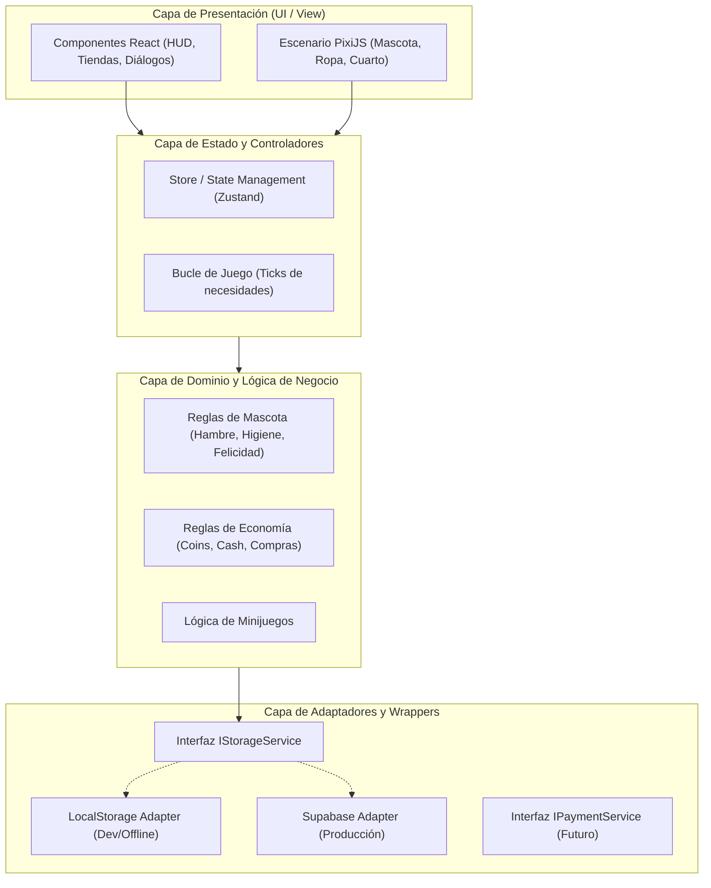

# Arquitectura de Sistema: Pet Society (Reborn)

## 1. Visión General
Pet Society es un juego casual de simulación de mascota virtual ejecutado en navegador web, con soporte responsive y táctil, diseñado bajo principios de Arquitectura Limpia, Separación de Responsabilidades (SoC) y desacoplamiento de servicios externos.

---

## 2. Capas del Sistema (Separación Estricta de Responsabilidades)



---

## 3. Principios de Diseño
1. **La UI es Tonta:** Los componentes React y las vistas de PixiJS no contienen cálculos de fórmulas de felicidad, ni validación de inventario, ni llamadas directas a almacenamiento. Solo despachan acciones y renderizan el estado.
2. **La Lógica es Ciega:** Las entidades del dominio no saben si se están renderizando en un Canvas WebGL, en un DOM HTML o probando en consola con Node.js.
3. **Persistencia Agnóstica (Repository Pattern):**
   - El juego consume `IStorageService`.
   - Fase inicial: `LocalStorageAdapter` para desarrollo ágil y sin dependencias externas.
   - Fase producción: Conexión transparente con `SupabaseStorageAdapter` sin tocar la lógica del juego.
4. **Economía Dual Preparada para Monetización:**
   - `coins`: Moneda regular del juego obtenida mediante recompensas, minijuegos y tareas.
   - `cash`: Moneda premium preparada para pasarelas de pago reales.
   - Todas las transacciones se auditan mediante un validador central de economía.

---

## 4. Estructura de Directorios Recomendada
```
src/
├── domain/            # Modelos de datos puros y reglas de negocio
│   ├── pet/           # Tipos de mascota, cálculo de estados
│   ├── inventory/     # Items, ropa, muebles, categorías
│   ├── economy/       # Reglas de compras, billetera
│   ├── shop/          # Catálogo comercial, lógica inmutable de compras y validaciones
│   └── minigame/      # Cinemática de pelota, gravedad, rebotes y cálculo de recompensas
├── infrastructure/    # Adaptadores a librerías y almacenamiento
│   ├── storage/       # IStorageService, LocalStorageAdapter, SupabaseAdapter
│   └── audio/         # Wrapper de audio
├── game/              # Motor gráfico 2D (PixiJS)
│   ├── pet/           # Renderizado de capas (cuerpo, ojos, ropa)
│   ├── room/          # Renderizado de habitación, muebles, colisiones
│   └── minigame/      # Escenario exterior de jardín y render de pelota deportiva
├── ui/                # Componentes visuales React (HUD, menús, popups)
│   ├── components/    # Botones, modales, barras de progreso
│   ├── hud/           # Barras de necesidades, balance de monedas
│   └── views/         # Pantallas (casa, tienda, minijuego)
└── styles/            # Tokens de diseño (colores, espaciados, tipografías)
```
